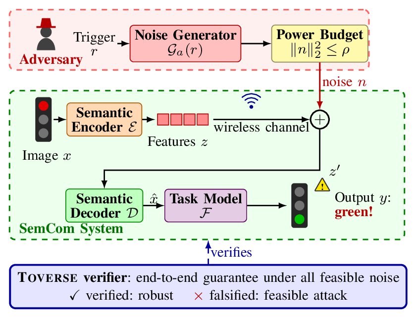
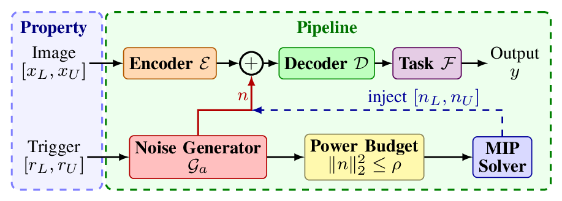

# Toverse: Task-Oriented Verification of Semantic Communication

Code of the paper of the same title.

Task-oriented semantic communication (SemCom) transmits only the semantic features that a task at the receiver requires, so the neural encoder and decoder become communication software that decides the quality of the service.
An adversary within range of the receiver can add low-power noise to these features, evade energy detection and flip the task prediction.
Toverse verifies this software before deployment on image transmission over two datasets, `FashionMNIST` and `CIFAR10`.



**Fig. 1 of the paper.**
The semantic encoder sends the features $z$ over the wireless channel, and the semantic decoder and the task model produce the prediction $y$ at the receiver.
The adversary maps a random trigger $r$ to noise $n = \mathcal{G}_a(r)$ through a trained generator, under the power budget $\|n\|_2^2 \le \rho$.
Toverse either verifies that no feasible noise flips the prediction or falsifies the property with a feasible attack.



**Fig. 2 of the paper.**
A mixed integer program (MIP) over the generator computes the noise intervals $[n_L, n_U]$ under the exact power budget.
Toverse injects these intervals at the semantic features in every bounding step of a branch-and-bound (BaB) verifier, and checks the exact power budget on every candidate attack.

## Tools

| Code name | Paper name | Role |
|---|---|---|
| `e2e_mip` | Toverse | NeuralSAT with the MIP noise intervals injected, and the power check on every candidate |
| `e2e` | NeuralSAT | verifier without the power constraint |
| `abcrown` | αβ-CROWN | verifier without the power constraint |
| `pgm` | PGM | attack that samples triggers of the generator; it cannot verify a property |

The code names are the names under which the results are stored.

## Directory structure

```
.
├── core              training, verification and figures; every command runs here
│   ├── experiment    settings of each benchmark: PNR, trigger range, input bound
│   ├── simulator
│   │   ├── model         semantic encoder, decoder, task model and generator
│   │   ├── trainer       training of the SemCom system and of the generator
│   │   ├── verifier      the four tools
│   │   └── util          MIP solver, ONNX and VNN-LIB handling
│   ├── scenario      runs, benchmark preparation and figures
│   │   ├── prepare       verification problems as ONNX and VNN-LIB files
│   │   └── plot          Figs. 3 to 5 and Table I
│   ├── abcrown       vendored αβ-CROWN
│   └── neuralsat     vendored NeuralSAT
├── lean              Lean 4 proof of Theorem 1
├── doc               Figs. 1 and 2 of the paper
└── data
    └── csv           summaries of the paper's results
```

`CLAUDE.md` holds the code style, the glossary from the paper notation to the code names, and the frozen names of the stored results.

## Installation

```bash
pip3 install -r requirement.txt
```

PyTorch is installed from the [PyTorch installation guide](https://pytorch.org/get-started/locally/), and the MIP step needs a [Gurobi](https://www.gurobi.com) license.
The experiments ran on a Linux machine with a 32-core AMD CPU, 128 GB RAM and an NVIDIA RTX 4090 GPU.
The proof needs Lean 4 `v4.33.1` with Mathlib, as `lean/README.md` describes.

## Data

FashionMNIST and CIFAR10 are downloaded by torchvision into `data/data/` on the first run.
Training writes the checkpoints, and `make prepare` writes the verification problems to `data/onnx/` and `data/vnnlib/`.
None of these folders is in this repository.

The summaries in `data/csv/` are committed, one `{tool}_{benchmark}.csv` per run, with the columns `sat`, `unsat` and `timeout` for the falsified, verified and timed-out problems.
The raw verifier logs in `data/log/` are in the repository [paper_verify_autoencoder](https://github.com/dynaroars/paper_verify_autoencoder), branch `aaai2027`.

## Reproducing the paper

Every problem has a 60-second timeout, and PGM has a 6-second one.
The benchmarks use a 16-dimensional feature space, with PNR $-10$ dB in RQ1 and RQ2 and four PNR levels from $-10$ to $-2.5$ dB in RQ3.

Train the SemCom system and the generators, and export the problems:

```bash
python3 main.py --trainer=semcom --dataset=fashion_mnist --experiment=fashion_mnist
python3 main.py --trainer=semcom --dataset=torch/cifar10 --experiment=cifar10
python3 main.py --trainer=pgm --dataset=fashion_mnist
python3 main.py --trainer=pgm --dataset=torch/cifar10 --experiment=cifar10
make train_ablation_fashion_mnist
make prepare prepare_ablation_fashion_mnist
```

Run the tools on each benchmark, with `fashion_mnist` replaced by `cifar10` for the second one:

```bash
python3 main.py --scenario=attack --experiment=fashion_mnist --verifier=pgm
python3 main.py --scenario=verify --experiment=fashion_mnist --verifier=e2e
python3 main.py --scenario=verify --experiment=fashion_mnist --verifier=abcrown
python3 main.py --scenario=verify --experiment=fashion_mnist --verifier=e2e_mip
make verify_ablation check_cex
```

| Paper result | Command | Problems | Reads |
|---|---|---|---|
| Fig. 3, Table I, RQ1 and RQ2 | `python3 main.py --scenario=plot_cactus` | 1500 | `data/csv/` |
| Fig. 4, RQ1 | `python3 main.py --scenario=plot_compare_iteration` and `--scenario=plot_compare_number_of_branch` | 1500 | `data/csv/`, `data/log/` |
| Fig. 5, RQ3 | `python3 main.py --scenario=plot_ablation` | 400 | `data/csv/` |
| Theorem 1 | `make proof` | | the axioms of every theorem |

The summaries are committed, so Figs. 3 and 5 and Table I regenerate without rerunning any verification.
Fig. 4 and `check_cex` also need the raw logs.
Every plot writes into `../../paper/figure/result/`, so this repository sits next to the paper as `../paper`.
